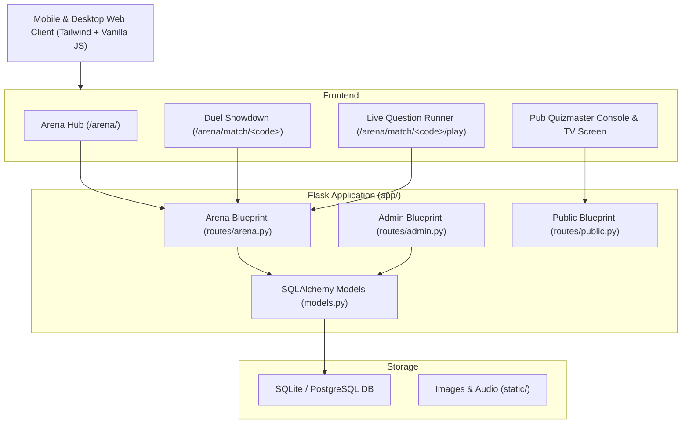

# Quizmondo Project Status & Change Log

**Project**: Quizmondo ([https://quizmondo.kangcono.com](https://quizmondo.kangcono.com))  
**Repository**: `C:\Users\trl\Documents\Agentic Projects\Quizmondo`  
**Latest Deployment Commit**: `e654c3f`  
**Last Updated**: October 26, 2026  

---

## 📌 Executive Summary
Quizmondo is an interactive, gamified trivia platform featuring:
1. **Multiplayer Head-to-Head Arena Duels** (Turn-based 6-round snake turn duels via WhatsApp deep link, registered friends list, online matchmaking, or against Cyber Bot Nova).
2. **Pub League / Live TV Mode** (Real-time live pub quiz manager with table check-in, strict round gating, and automated scoring).
3. **Visual Trivia Matching Categories** (Flags, football club badges, brand logos, country shapes with over 600+ verified visual questions).
4. **Player Ranks & Gamification** (XP, Coins, Streaks, 24 selectable champion avatars, and 3-step Superhero Name + PIN registration).
5. **Quizmondo Admin Control Centre** (Role-based access control, question authoring studio, user management, and duel maintenance).

---

## 🛠️ Architecture & Core Components

---

## 📋 Comprehensive Change Log by Feature Area

### 1. Multiplayer Arena & Duel Workflow
* **Dedicated Duel Categorization on Arena Hub (`arena_dashboard.html`, `routes/arena.py`)**:
  * Duels are organized into 3 clear sections:
    1. **📥 Challenges For You**: Duels sent to you by other players, with origin tags (`Challenged You`), round progress, and **`YOUR TURN 🎮`** or **`WAITING ⏳`** status.
    2. **📤 Invites & Duels You Sent**: Listed at the top with recent WhatsApp invites (`Waiting for friend to accept (Round 1)`), recipient names, and rematch shortcuts.
    3. **🤖 Bot Nova Practice Duels**: Isolated solo training section against Cyber Bot Nova.
  * Added **Friend Name Input** on the *Challenge a Friend* card so players can label invites (e.g. "Dave", "Sarah") before sending them on WhatsApp.
* **Single WhatsApp Invite Flow**:
  * WhatsApp invite is shown **only once** in Step 1 (prior to playing Round 1).
  * Removed confusing secondary WhatsApp buttons after Round 1 was completed; replaced with status badge: `✅ Round 1 Score Locked In • Waiting for Friend`.
* **Completed Duel State & Rematch Handling**:
  * Completed matches display **`🏆 COMPLETED • CLICK TO REMATCH`** on the Arena Hub instead of remaining in a `WAITING ⏳` state.
  * Clicking Rematch triggers a race-free workflow: the first clicker creates the rematch and starts Round 1; the opponent's screen auto-updates to `🔥 [Opponent] Started a Rematch! Join Rematch Now →`.
* **Cleaned Frontend Copy**:
  * Removed internal developer-style and meta instructions (e.g., *"no need to nudge on WhatsApp"*, *"snake turn sync"*, *"auto-syncing live every 2.5s"*, *"stage-gated answer reveal"*).
  * Replaced with natural game phrasing (e.g., *"Waiting for opponent"*, *"Head-to-head breakdown"*, *"Challenge other friends"*).

---

### 2. Avatar System & Mascot Graphics
* **24 Selectable Champion Avatars**:
  * Expanded preset avatars from 4 to 24 distinct choices: *Quizzy (`⭐`), Pixel (`👾`), Sage (`🦉`), Astro (`🧑‍🚀`), Blaze (`🔥`), Volt (`⚡`), Shadow (`🥷`), Rex (`🦖`), Kitsune (`🦊`), Titan (`🛡️`), Vortex (`🐉`), Maverick (`🦅`), Phantom (`👻`), Apex (`🦁`), Neptune (`🦈`), Cobra (`🐍`), Bamboozle (`🐼`), Stardust (`🦄`), Valhalla (`⚔️`), Merlin (`🧙‍♂️`), Corsair (`🏴‍☠️`), Onyx (`🐆`), Kraken (`🐙`), Monarch (`👑`)*.
* **Nova Exclusivity**:
  * Reserved `'nova'` exclusively for **Cyber Bot Nova** (`bot_quizmondo_ai`). Existing human players with `nova` were safely migrated to `astro`.
* **Visual Rendering (`mascot_character.html`)**:
  * Implemented `render_avatar_badge()` macro to display SVG/graphic badges rather than truncating raw text keys (which previously showed `PIXE` or `PIXEL` instead of the 8-bit bot).
  * Included fallback to username (`display_name`) if no avatar is set.
  * Fixed an issue where the string `'mx-auto'` was being passed into speech bubble containers.

---

### 3. Real-Time Notifications & Mobile Responsiveness
* **Audio Alerts & Global Bell**:
  * Added a Web Audio API 4-note harmonic bell chime (`A5 → D6 → E6 → A6`) in `base.html` that triggers on new turns and challenge notifications.
  * Added user interaction audio unlocking (`pointerdown`, `touchstart`) for mobile Safari/Chrome policy compliance.
* **Fixed Mobile Dropdown Positioning**:
  * Resolved an issue where `#arenaNotifDropdown` rendered off-screen on mobile devices by changing styling from `absolute right-0 w-80` to `fixed left-3 right-3 top-16 sm:absolute sm:left-auto sm:right-0 sm:top-full`.
* **Cross-Game Turn Alerts (`base.html`)**:
  * Background polling (`/arena/api/notifications`) polls every 5 seconds.
  * Displays friendly toast notifications (`showLiveArenaToast`) with 1-tap navigation when an opponent finishes their turn while the player is in another game or browsing decks.

---

### 4. Visual Trivia & Content
* **Visual Image Categories (`upgrade_visual_games.py`, `quiz_seed.py`)**:
  * Flag questions: 170 visual image questions vs 80 text questions.
  * Football badges: 139 visual image questions vs 80 text questions.
  * Brand logos: 142 visual image questions vs 80 text questions.
  * Country shapes: 147 visual image questions vs 80 text questions.
  * Prioritizes visual matching (`question_type == 'image'`) for standard duels, relegating text-only questions to expert difficulty modes.

---

### 5. Pub Quiz System & Control Centre
* **Strict Quizmaster Gating**:
  * Next Round button remains locked until all registered tables have submitted answers or the Quizmaster explicitly activates the *Lock / Time's Up* command.
  * Reset commands on the host console propagate to all connected tables without requiring manual refreshes.
* **Admin Control Centre (`/admin/`)**:
  * Shaded, color-coded sidebar navigation with high-contrast text.
  * Role management: Super Admin, Admin, Quizmaster, Creator, Player.
  * Maintenance utility for clearing duels and resetting test content with password protection.

---

## 🗄️ Database Schema Reference (Core Models)

| Model | Table | Key Fields | Description |
|---|---|---|---|
| `User` | `users` | `id`, `username`, `email`, `role`, `pin_hash` | Core user accounts with role gating (`super_admin`, `admin`, `quizmaster`, `creator`, `player`). |
| `PlayerProfile` | `player_profiles` | `session_key`, `display_name`, `avatar_key`, `xp`, `level`, `coins` | Gamification profile linked to session or `User.id`. |
| `ArenaMatch` | `arena_matches` | `match_code`, `player1_session`, `player2_session`, `status`, `current_round`, `current_turn` | 6-round head-to-head match records. |
| `ArenaRound` | `arena_rounds` | `match_id`, `round_number`, `category_slug`, `p1_score`, `p2_score`, `status` | Individual round details and submitted answers. |
| `QuizQuestion` | `quiz_questions` | `prompt`, `question_type`, `media_url`, `options_json`, `correct_option`, `category_slug` | Over 3,300 trivia questions across 15 packs. |

---

## 🚀 Active Production Matches Preserved
During database cleanup, all stale test duels were cleared while preserving active matches:
- `#qm_b3835377`: `StarlightSpark` vs `trevorl` (Completed, Round 6/6)
- `#qm_d760b9f7`: `trevorl` vs `StarlightHawk88` (In Progress, Round 1/6)
- `#qm_7ff82fd0`: `StarlightSpark` vs `trevorl` (Completed, Round 6/6)
- `#qm_9bf35030`: `trevorl` vs `StarlightSpark` (Completed, Round 6/6)
